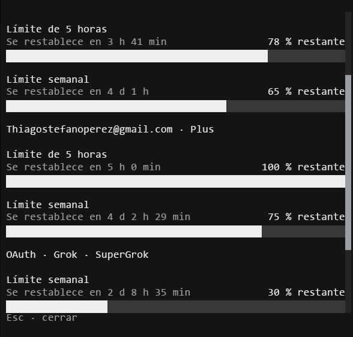

# usage

[OpenCode V2](https://opencode.ai/v2/docs/build/plugins) plugin: `/usage` shows remaining subscription quota for saved Codex and Grok OAuth connections without invoking a model.

## Screenshots



## Install

Requires OpenCode V2 (official plugin API 2.0.26) and Node.js 22+ for dependency installation and tests. This repository is not published to npm.

```sh
git clone https://github.com/Thiago-P05/usage.git
cd usage
npm ci --ignore-scripts --omit=optional
npm test
```

Merge into `opencode.json(c)` (use your clone's absolute path; preserve other settings):

```json
{
  "$schema": "https://opencode.ai/config.json",
  "plugins": ["/absolute/path/usage"]
}
```

The `./tui` export loads automatically; do not add it again in `cli.json`. Start a new OpenCode interface, then use `/usage` or the Usage palette command. Remove the entry to disable. OpenTUI/Solid peers are supplied by the CLI host; the optional peers are not installed for headless tests.

## Privacy and limitations

- Uses OpenCode's native connection resolver. Native OAuth refresh may occur; the plugin does not switch the active account or implement its own refresh.
- Sends credentials only to the applicable quota endpoints: `chatgpt.com/backend-api/wham/usage` and `cli-chat-proxy.grok.com/v1/billing` / `v1/settings`. These client endpoints are not guaranteed public, versioned APIs.
- Credentials stay server-side in memory. No quota or credential files are written. The UI avoids account identifiers, but native connection labels may contain personal information; inspect labels before sharing screenshots or text reports.
- Unknown quota stays unknown. Ambiguous identities are rejected, not silently replaced with the active connection. API-key subscriptions and unsupported integrations are not represented as OAuth quota.
- `runtime-check.js` is an optional Windows-specific diagnostic that contacts a real OpenCode service and can trigger native credential resolution/provider requests. It is **not** part of the safe test suite; do not run it on untrusted installations.

## Checks

`npm test` uses fabricated credentials and mocked network/context objects, not user accounts. Fixture emails use `example.invalid`; JWTs are synthesized, not live tokens. Node tests do not prove terminal rendering or live provider compatibility. Dependencies are locked; installation scripts are deliberately disabled.

MIT — [LICENSE](LICENSE). Repository: [Thiago-P05/usage](https://github.com/Thiago-P05/usage).
